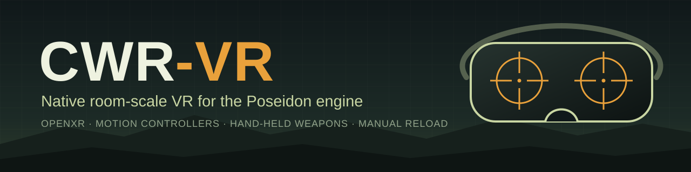

<p align="center">
  
</p>

<p align="center">
  <a href="LICENSE"></a>
  
  
  
</p>

<p align="center">
  <b>English</b> · <a href="README.uk.md">Українська</a>
</p>

**CWR-VR** is a community fork of Bohemia Interactive's open-source *Poseidon* engine that adds native VR through OpenXR. It is built for room-scale infantry play: you hold the weapon in your hand, aim it down its own sights and reload it by hand.

> [!IMPORTANT]
> This is an unofficial project, not affiliated with or endorsed by Bohemia Interactive. It contains no game data, so you need your own copy of the game to play.

## Features

- **Stereo rendering:** head tracking, asymmetric per-eye projection, HUD on its own layer, and menus on a virtual screen.
- **Hand-held weapons:** the weapon follows the controller, shots leave from the barrel, and the left hand can take a two-handed grip.
- **Body:** the soldier's arms follow the weapon, and the eye height follows stance.
- **Manual reload:** eject the magazine, take a new one from the chest pouch, insert it and rack the charging handle.
- **Magazines are real objects:** a dropped magazine falls to the ground and leaves your inventory with its rounds. In a tactical reload you can put the old one back in the pouch.
- **Moving parts:** the bolt cycles at each shot and locks back on an empty magazine, and the dust cover opens.
- **Telescopic sights:** you look through the lens on the weapon itself, and only with your eye in the right place.
- **Sounds per gesture:** each reload step plays its own part of the reload sound.
- **Flat play still works:** without `--vr` the game runs as a normal desktop game.

## Requirements

| | |
|---|---|
| **OS** | Windows 10 or 11, x64 (VR is Windows-only for now) |
| **Headset** | Meta Quest or Pico over Virtual Desktop (VDXR runtime); SteamVR as a fallback |
| **OpenXR** | A runtime with `XR_KHR_opengl_enable` |
| **Game data** | Your own Steam install of the game, v3.05 ([free Demo data](#game-data) also exists) |

## Build

```sh
cmake --preset win-x64-clang-rwdi
cmake --build build/win-x64-clang-rwdi
```

The game and `vr.pbo` land in `dist/x64-win-rwdi/`.

## Run

Start your OpenXR runtime, then run the game with the game data folder as the working directory:

```sh
PoseidonGame.exe --vr
```

| Flag | What it does |
|---|---|
| `--vr` | Shows the game in the headset through OpenXR |
| `--vr-fake` | VR without a headset, using scripted poses (implies `--vr`) |
| `--vr-mirror` | Shows both eyes side by side in the window |

## Controls

| Control | Action |
|---|---|
| Left stick | Walk |
| Right stick left / right | Turn (snap or smooth) |
| Right stick up / down | Previous / next action |
| Right stick click | Recentre |
| Right trigger | Fire |
| Left trigger | Optics |
| Left grip | Hold the fore-end, take a magazine, or pull the charging handle |
| B | Eject the magazine |
| Left grip + left stick click | Place the magazine pouch where your hand is |
| Menu | Pause |

The controllers reach the game as a virtual gamepad, so the other buttons follow the game's own gamepad bindings, which you can change in the controls menu.

## Tuning

Hand offsets, pouch position, turning, sights and more live in `vr.ini` next to the executable. The game re-reads the file while it runs, and the debug overlay has a VR tab with sliders for many of the values. Delete `vr.ini` to get the defaults back.

Everything VR writes to `vr.log`: the runtime, its extensions, frame timing and errors. Attach it when you report a problem.

## Roadmap

- [x] OpenXR session and the flat game on a virtual screen
- [x] Stereo rendering and head tracking
- [x] Controllers, turning and recentring
- [x] Weapon at the controller, two-handed grip
- [x] Arms follow the weapon, eye height follows stance
- [ ] **Manual reload** (in progress)
- [ ] Hand tracking (`XR_EXT_hand_tracking`)
- [ ] Vehicles, binoculars and the map in the hand

## Repository layout

- [`engine/PoseidonVR`](engine/PoseidonVR) - OpenXR session and virtual gamepad
- [`engine/PoseidonGL33`](engine/PoseidonGL33) - OpenGL backend, including `EngineGL33_VR.cpp`
- [`resources/vr`](resources/vr) - original VR model parts and the script that generates them
- [Apps](apps/README.md) - executable targets
- [Engine](engine/README.md) - engine libraries and Rust Trident tooling
- [Master server tools](mserver/README.md) - Rust service and CLI crates
- [Tests](tests/README.md) - test source trees

Code changed in existing engine files is marked with `// VR:`.

## Game data

The compiled binaries need game data to run. Game data (models, textures, sounds, missions) is **not part of this repository** and is **not** covered by the GPL. Bohemia Interactive releases it separately under the **Arma Public License Share Alike (APL-SA)**:

- License text: <https://www.bohemia.net/community/licenses/arma-public-license-share-alike>
- Free Demo game data on Steam: <https://store.steampowered.com/app/4819000>

The parts in [`resources/vr`](resources/vr) are not game data. [`make_parts.py`](resources/vr/make_parts.py) generates them from scratch, and they are under the same license as the code.

## License

The source in this repository is licensed under the **GNU General Public License v3.0 *or later***, with additional terms under **Section 7** of the GPL. See [`LICENSE`](LICENSE) for the full text. You may use, study, modify and redistribute it, provided it stays GPL and you follow those terms.

This license does not grant you any right to use "ARMA" or any other Bohemia Interactive trademark.

The [`thirdparty/`](thirdparty) directory is **excluded** from the project's GPL license: it contains vendored third-party code under its own licenses, see [`thirdparty/README.md`](thirdparty/README.md). Dependencies pulled in via vcpkg ([`vcpkg.json`](vcpkg.json)) likewise remain under their own licenses. See also [Credits](CREDITS.md) and [Third-party notices](THIRD_PARTY_NOTICES.md).

*"ARMA" is a registered trademark of BOHEMIA INTERACTIVE a.s. "OPERATION FLASHPOINT" is a registered trademark of Electronic Arts Inc. See [`LICENSE`](LICENSE) for information concerning trademarks. This notice is informational and does not constitute any grant and/or waiver of rights.*

## Credits

CWR-VR builds on the engine source code released by [Bohemia Interactive](https://github.com/BohemiaInteractive/CWR).
