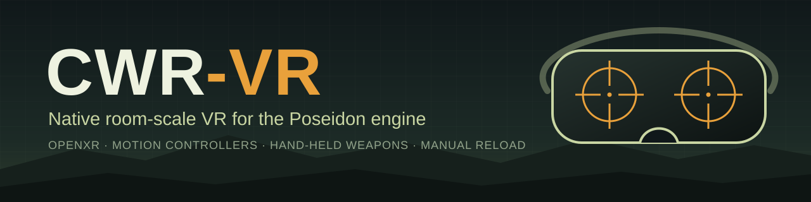

<p align="center">
  
</p>

<p align="center">
  <a href="LICENSE"></a>
  
  
  
</p>

<p align="center">
  <a href="README.md">English</a> · <b>Українська</b>
</p>

**CWR-VR** — це спільнотний форк відкритого рушія *Poseidon* від Bohemia Interactive, який додає нативну VR через OpenXR. Проєкт створено для гри за піхоту з рухом по кімнаті: ви тримаєте зброю в руці, цілитеся через її власний приціл і перезаряджаєте її вручну.

> [!IMPORTANT]
> Це неофіційний проєкт, не пов'язаний із Bohemia Interactive і не схвалений нею. Він не містить ігрових даних, тому для гри потрібна власна копія гри.

## Можливості

- **Стереорендеринг:** відстеження голови, асиметрична проєкція для кожного ока, HUD на окремому шарі, меню на віртуальному екрані.
- **Зброя в руці:** зброя йде за контролером, постріл вилітає зі ствола, а лівою рукою можна взяти зброю двома руками.
- **Тіло:** руки солдата йдуть за зброєю, а висота очей залежить від положення тіла.
- **Ручна перезарядка:** витягти магазин, узяти новий із підсумка на грудях, вставити його й пересмикнути затвор.
- **Магазини як справжні предмети:** скинутий магазин падає на землю і зникає з вашого спорядження разом із набоями. Під час тактичної перезарядки старий магазин можна повернути в підсумок.
- **Рухомі частини:** затвор рухається при кожному пострілі й стає на затримку, коли магазин порожній, а пилозахисна кришка відкривається.
- **Оптичні приціли:** ви дивитеся в лінзу на самій зброї, і зображення видно лише тоді, коли око в правильному положенні.
- **Звук кожного жесту:** кожен крок перезарядки відтворює свою частину звуку.
- **Звичайна гра працює:** без `--vr` це звичайна гра для монітора.

## Вимоги

| | |
|---|---|
| **ОС** | Windows 10 або 11, x64 (VR поки що лише на Windows) |
| **Шолом** | Meta Quest або Pico через Virtual Desktop (рантайм VDXR); запасний варіант — SteamVR |
| **OpenXR** | Рантайм із `XR_KHR_opengl_enable` |
| **Ігрові дані** | Власна копія гри зі Steam, версія 3.05 (є також [безкоштовні дані демоверсії](#ігрові-дані)) |

## Збірка

```sh
cmake --preset win-x64-clang-rwdi
cmake --build build/win-x64-clang-rwdi
```

Гра і `vr.pbo` з'являться в `dist/x64-win-rwdi/`.

## Запуск

Запустіть рантайм OpenXR, а потім гру, зробивши теку з ігровими даними робочою:

```sh
PoseidonGame.exe --vr
```

| Прапорець | Що робить |
|---|---|
| `--vr` | Показує гру в шоломі через OpenXR |
| `--vr-fake` | VR без шолома, зі скриптовими позами (вмикає `--vr`) |
| `--vr-mirror` | Показує обидва ока поруч у вікні |

## Керування

| Елемент | Дія |
|---|---|
| Лівий стік | Ходьба |
| Правий стік вліво / вправо | Поворот (ривками або плавно) |
| Правий стік вгору / вниз | Попередня / наступна дія |
| Натискання правого стіка | Центрування |
| Правий курок | Постріл |
| Лівий курок | Приціл |
| Ліва кнопка хвату | Узятися за цівку, взяти магазин або потягнути рукоятку затвора |
| B | Витягти магазин |
| Ліва кнопка хвату + натискання лівого стіка | Поставити підсумок там, де зараз рука |
| Menu | Пауза |

Контролери потрапляють у гру як віртуальний геймпад, тому решта кнопок працює за ігровими прив'язками геймпада. Їх можна змінити в меню керування.

## Налаштування

Зміщення рук, положення підсумка, повороти, приціли та інше зберігаються у `vr.ini` поруч з виконуваним файлом. Гра перечитує цей файл під час роботи, а в налагоджувальному оверлеї є вкладка VR із повзунками для багатьох значень. Щоб повернути стандартні значення, видаліть `vr.ini`.

Усе, що стосується VR, записується у `vr.log`: рантайм, його розширення, час кадрів і помилки. Додавайте цей файл, коли повідомляєте про проблему.

## План робіт

- [x] Сесія OpenXR і звичайна гра на віртуальному екрані
- [x] Стереорендеринг і відстеження голови
- [x] Контролери, повороти й центрування
- [x] Зброя в контролері, хват двома руками
- [x] Руки йдуть за зброєю, висота очей залежить від положення тіла
- [ ] **Ручна перезарядка** (у роботі)
- [ ] Техніка, бінокль і карта в руці

## Структура репозиторію

- [`engine/PoseidonVR`](engine/PoseidonVR) — сесія OpenXR і віртуальний геймпад
- [`engine/PoseidonGL33`](engine/PoseidonGL33) — бекенд OpenGL, зокрема `EngineGL33_VR.cpp`
- [`resources/vr`](resources/vr) — власні деталі моделей для VR і скрипт, який їх створює
- [Застосунки](apps/README.md) — виконувані цілі
- [Рушій](engine/README.md) — бібліотеки рушія та інструменти Trident на Rust
- [Майстер-сервер](mserver/README.md) — сервіс і CLI на Rust
- [Тести](tests/README.md) — вихідний код тестів

Зміни в наявних файлах рушія позначено коментарем `// VR:`.

## Ігрові дані

Для запуску потрібні ігрові дані. Вони (моделі, текстури, звуки, місії) **не входять до цього репозиторію** і **не** підпадають під GPL. Bohemia Interactive випускає їх окремо за ліцензією **Arma Public License Share Alike (APL-SA)**:

- Текст ліцензії: <https://www.bohemia.net/community/licenses/arma-public-license-share-alike>
- Безкоштовні дані демоверсії у Steam: <https://store.steampowered.com/app/4819000>

Деталі в [`resources/vr`](resources/vr) не є ігровими даними. Їх з нуля створює скрипт [`make_parts.py`](resources/vr/make_parts.py), і вони мають ту саму ліцензію, що й код.

## Ліцензія

Вихідний код цього репозиторію поширюється за ліцензією **GNU General Public License v3.0 *or later*** із додатковими умовами за **розділом 7** GPL. Повний текст див. у [`LICENSE`](LICENSE). Англійська версія [README](README.md#license) містить повне формулювання, зокрема щодо торговельних марок.

Ця ліцензія не надає жодних прав на використання "ARMA" чи інших торговельних марок Bohemia Interactive. Тека [`thirdparty/`](thirdparty) не підпадає під GPL проєкту: див. [`thirdparty/README.md`](thirdparty/README.md).

*"ARMA" є зареєстрованою торговельною маркою BOHEMIA INTERACTIVE a.s. "OPERATION FLASHPOINT" є зареєстрованою торговельною маркою Electronic Arts Inc.*

## Подяки

CWR-VR побудовано на вихідному коді рушія, опублікованому [Bohemia Interactive](https://github.com/BohemiaInteractive/CWR).
